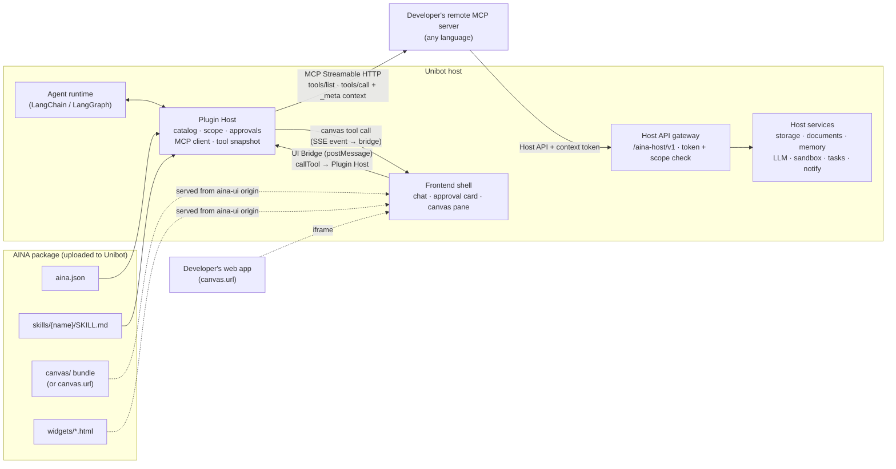
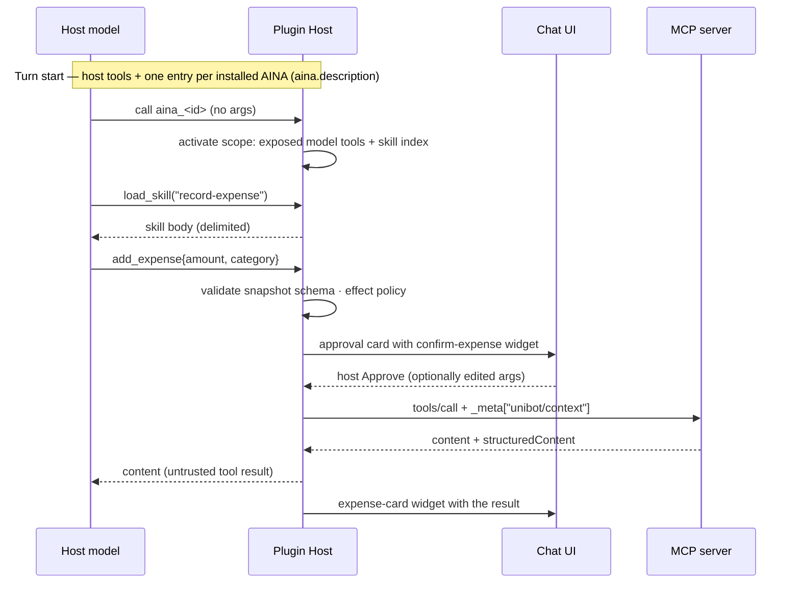

# AINA Protocol 2.0 — Plugin Contract Design

Status: **Accepted; P0, P1, P2, P3 and P6 implemented** · rev 4, 2026-10-17 · See §17 for what is built and where it
differs.

Revision 2: an AINA package is now four developer-provided parts — **tools** (remote MCP only), **canvas**,
**skills** and **widgets** — described by a JSON manifest (`aina.json`). The custom plugin RPC and the managed runtime
from rev 1 are dropped.

Revision 4: every open decision in §16 is resolved as recommended, and implementation of P0 (spec, validator,
example) and P1 (tools and skills) has started (§17).

Revision 3: skills are folders (`<skill_name>/SKILL.md` or `skill.md`); a canvas may be an embedded URL (iframe) as
well as a packaged bundle; and the end state adds **canvas tools** — tools implemented by the open canvas, so the
agent can change what the user sees (for example `draw_circle` on an Excalidraw canvas, §9.5).

## 0. Summary

Today an AINA can only reach the depth of Memory, Documents or Code Runner if it is written *inside* Unibot: those
"built-in" AINAs are wired by hard-coded IDs through the capability catalog, executor, prompt builder and frontend.
A third-party AINA gets a much thinner contract — one black-box `input: string` entry, no tools of its own, no access
to host services, and only four generic widget kinds.

This design replaces that split with **one package format that every AINA uses, including Unibot's own**. A developer
provides:

| Part | What it is | Where it runs |
|---|---|---|
| **Tools** | A remote MCP server (Streamable HTTP). Its tools are what the host agent can call. | Developer's server |
| **Canvas** | The AINA's main interface (e.g. a document editor or a whiteboard): a static web bundle in the package, or an external web app embedded by URL. It may also implement **canvas tools** the agent can call. | Sandboxed iframe in the canvas pane |
| **Skills** | Skill folders (`<skill_name>/SKILL.md`) with Markdown workflows that teach the agent how to use the tools for a task. | Loaded into the agent's context on demand |
| **Widgets** | Small web UIs shown in the conversation, e.g. a confirmation before a tool runs or a result card. | Sandboxed iframe inline in chat |

All metadata lives in **`aina.json`**. The canvas and widgets talk to the host only through a `postMessage` bridge.
The MCP server may call back into Unibot through a permission-scoped **Host API**. The agent changes durable data
through MCP tools and changes what is on screen through canvas tools, so the conversation can drive the canvas
directly. A developer needs the published spec, any
MCP SDK, a small UI SDK and a CLI — never Unibot's source. First-party AINAs are rebuilt on the same format; the
`builtin` runtime type and every per-AINA branch in host code are removed.

## 1. Problem: where the implementation diverges from the architecture

The intended architecture ([MVP requirements](../.docs/unibot-mvp/requirements.md) §1, §2.1, §7) says AINA Protocol
"decouples the Agent framework from concrete applications", must be language-agnostic, support structured UI and
fine-grained permissions, and let the framework grow "without modifying the Agent core logic". The README's iPhone
analogy says the same: system capabilities plus installable apps.

| # | Divergence | Evidence |
|---|---|---|
| 1 | Built-in AINAs get scoped, fine-grained tools; the scope is chosen by hard-coded ID branches. | [capabilities.py:179-190](../backend/src/tianzhou_agent_platform/services/agent_integration/capabilities.py:179), [:321](../backend/src/tianzhou_agent_platform/services/agent_integration/capabilities.py:321), [:710](../backend/src/tianzhou_agent_platform/services/agent_integration/capabilities.py:710) |
| 2 | Third-party AINAs are a single opaque `{input: string}` call; their manifest `tools` can only reference tools *already published in the platform registry*, not tools the AINA implements. | [capabilities.py:192-197](../backend/src/tianzhou_agent_platform/services/agent_integration/capabilities.py:192), [:309](../backend/src/tianzhou_agent_platform/services/agent_integration/capabilities.py:309), [gateway.py `invoke_aina`](../backend/src/tianzhou_agent_platform/aina/gateway.py) |
| 3 | Built-in tool execution is a dispatcher that imports domain services directly. | [builtin.py `invoke_builtin`](../backend/src/tianzhou_agent_platform/aina/builtin.py), [executor.py:104](../backend/src/tianzhou_agent_platform/services/agent_integration/executor.py:104), [:166](../backend/src/tianzhou_agent_platform/services/agent_integration/executor.py:166) |
| 4 | Product behaviour keyed to specific AINAs inside the agent layer (document prompt, edit-task direct reply). | [prompts.py:62](../backend/src/tianzhou_agent_platform/services/agent_integration/prompts.py:62), [executor.py:180](../backend/src/tianzhou_agent_platform/services/agent_integration/executor.py:180) |
| 5 | Widget kinds are a closed enum that includes built-in-only kinds (`memory`, `document`, `document_outline`). | [widgets.py:47](../backend/src/tianzhou_agent_platform/aina/protocol/widgets.py:47), [models.py:81](../backend/src/tianzhou_agent_platform/aina/protocol/models.py:81) |
| 6 | Rich canvases are host React components selected by `ainaId`; they call bespoke host REST APIs (`/memories`, `/sandboxes`, `/vision`, `/documents`). | [MainWidgetRenderer.tsx:41-57](../frontend/src/components/widgets/MainWidgetRenderer.tsx:41), [PluginUi.tsx:25](../frontend/src/components/apps/PluginUi.tsx:25) |
| 7 | No host services exist for plugins: no plugin storage, no document/memory/LLM/sandbox access, no config schema, no secrets. | `InstallationRequest.configuration` is an untyped dict; `permissions` are free strings |
| 8 | Skills are a manifest field that only feeds one prompt string; there is no way to ship a reusable workflow. | `AinaCapability.instructions` in [models.py](../backend/src/tianzhou_agent_platform/aina/protocol/models.py) |
| 9 | Managed AINAs hand-roll a custom envelope (`request_id`, `trace_id`, `usage`) in every handler. | [examples/hello-aina/src/main.py](../examples/hello-aina/src/main.py) |

The root cause is the same in every row: **the protocol is too thin to express what Unibot's own apps need, so those
apps bypass it.** Fixing this means making the protocol rich enough that they no longer need to. Special-casing more IDs
would not fix it.

## 2. Goals and non-goals

**Goals**

- G1. A developer can build, test, package and ship an AINA using only the public spec, an MCP SDK, the UI SDK and CLI.
- G2. One package format for first-party and third-party AINAs; host code contains no AINA IDs.
- G3. AINAs expose their own tools to the host agent, with per-tool effects and approvals.
- G4. AINAs provide their own canvas and conversation widgets without shipping code into the host's origin.
- G5. AINAs ship skills that guide the agent through multi-step workflows over their tools.
- G6. AINAs reach host data and services only through declared, user-granted, auditable permissions.
- G7. Language- and model-vendor-agnostic: tools are standard MCP, so any MCP server implementation works.
- G8. The agent can operate an open canvas through tools the canvas provides, with the same schemas, effects and
  approvals as any other tool.

**Non-goals (2.0)**

- Unibot hosting developer backend code (the 1.0 managed runtime); local/stdio MCP servers.
- MCP resources, prompts, sampling and elicitation (skills, widgets and the Host API cover these needs).
- Marketplace, billing, review workflow, publisher signing PKI.
- AINA-to-AINA direct calls (the host agent remains the only orchestrator).
- Replacing the host agent loop; AINAs never receive the host's model loop or full conversation by default.

## 3. Design principles

1. **The host owns the agent.** AINAs contribute tools, skills and UI; Unibot decides when to use them.
2. **Contract, not code.** Everything an AINA can do is in the spec. A first-party AINA that needs something new must
   get it added to the spec, so third parties get it too.
3. **Standard where a standard exists.** Tools are plain MCP; Unibot adds only what MCP lacks (install, consent,
   skills, canvas, widgets, Host API).
4. **Least privilege, explicit consent.** Every host resource sits behind a permission scope; every scope is shown at
   install; tokens carry only granted scopes and expire quickly.
5. **The package is the security boundary.** Exposed tools, UI files, skills and permissions are fixed per version;
   a live MCP server cannot add tools or rewrite descriptions without a new version (no rug-pull, no tool poisoning).
6. **AINA output is untrusted data.** Tool results and widgets never become host instructions; skills only enter the
   context while that AINA is active, inside a delimited block. Approval decisions are always host-owned controls.

## 4. Architecture overview



| Channel | Direction | Transport | Purpose |
|---|---|---|---|
| Package | upload | zip: `aina.json` + static files | Identity, tool policy, skills, UI files, config, permissions |
| Tools | host → MCP server | MCP Streamable HTTP | Discover (at registration) and call tools |
| Host API | MCP server → host | HTTPS REST, bearer context token | Use host data and services within granted scopes |
| UI Bridge | canvas/widget iframe ↔ host | `postMessage` JSON-RPC | Read context, call tools, send prompts, confirm edits |
| Canvas tools | host → open canvas | SSE event to the shell, then bridge into the iframe; result posted back | The agent changes what the canvas shows (§9.5) |

Packaged canvases and widgets **never** talk to the MCP server directly and never see a host token. They call tools
through the host, which applies the same authorization, approval and tracing as agent calls. A URL canvas is the
developer's own web app and may also talk to its own backend (§9.1).

## 5. Package and manifest

### 5.1 Package layout

```text
com.example.expenses-1.2.0.aina.zip
├── aina.json                 # the only manifest; JSON
├── README.md
├── assets/
│   └── icon.svg
├── skills/
│   ├── record-expense/
│   │   └── SKILL.md          # SKILL.md or skill.md, exactly one
│   └── monthly-close/
│       ├── SKILL.md
│       └── references/
│           └── categories.md # optional supporting files, read on demand
├── canvas/                   # optional; static files only (omit when canvas.url is used)
│   ├── index.html
│   └── app.js
└── widgets/                  # optional; static files only
    ├── confirm-expense.html
    └── expense-card.html
```

The package contains no backend code; tools are served by the developer's MCP server. Packaged UI files may reference
only other files inside the package (no remote scripts), so the reviewed package is exactly what runs. A canvas that
must load remote content is declared as a URL canvas instead (§9.1).

### 5.2 `aina.json` example

```json
{
  "$schema": "https://unibot.example/schemas/aina/2.0/aina.schema.json",
  "protocol_version": "2.0",

  "aina": {
    "id": "com.example.expenses",
    "version": "1.2.0",
    "name": "Expenses",
    "description": "Record, categorize and summarize the user's expenses.",
    "publisher": { "id": "example", "name": "Example Inc.", "url": "https://example.com" },
    "icon": "assets/icon.svg",
    "locales": {
      "zh-CN": { "name": "报销助手", "description": "记录、分类并汇总用户的支出。" }
    }
  },

  "tools": {
    "mcp": {
      "url": "https://expenses.example.com/mcp",
      "auth": { "type": "bearer", "secret": "api_token" }
    },
    "expose": {
      "add_expense": {
        "effect": "write",
        "visibility": ["model", "app"],
        "confirm_widget": "confirm-expense",
        "result_widget": "expense-card"
      },
      "list_expenses": { "effect": "read", "visibility": ["model", "app"] },
      "delete_expense": { "effect": "destructive", "visibility": ["model", "app"] },
      "sync_bank": { "effect": "write", "visibility": ["app"] }
    }
  },

  "skills": [
    {
      "id": "record-expense",
      "name": "Record an expense",
      "description": "Use when the user mentions money they spent and wants it recorded.",
      "path": "skills/record-expense",
      "tools": ["add_expense", "list_expenses"]
    },
    {
      "id": "monthly-close",
      "name": "Monthly close",
      "description": "Use when the user wants to reconcile and summarize one month of expenses.",
      "path": "skills/monthly-close",
      "tools": ["list_expenses", "delete_expense", "highlight_rows"]
    }
  ],

  "canvas": {
    "entry": "canvas/index.html",
    "title": "Expenses",
    "tools": [
      {
        "name": "highlight_rows",
        "description": "Highlight expense rows in the open Expenses canvas so the user can review them.",
        "inputSchema": {
          "type": "object",
          "properties": { "expense_ids": { "type": "array", "items": { "type": "string" }, "maxItems": 200 } },
          "required": ["expense_ids"],
          "additionalProperties": false
        },
        "effect": "read"
      }
    ]
  },

  "widgets": [
    { "id": "confirm-expense", "purpose": "confirmation", "entry": "widgets/confirm-expense.html", "height": 160 },
    { "id": "expense-card", "purpose": "result", "entry": "widgets/expense-card.html", "height": 120 }
  ],

  "config": {
    "schema": {
      "type": "object",
      "properties": {
        "currency": { "type": "string", "default": "CNY", "title": "Default currency" },
        "api_token": { "type": "string", "title": "Expenses API token", "x-secret": true }
      },
      "required": ["api_token"]
    }
  },

  "permissions": [
    { "scope": "storage" },
    { "scope": "documents.read", "reason": "Import receipts that you saved as documents." },
    { "scope": "llm", "reason": "Categorize free-text receipts." }
  ]
}
```

### 5.3 Field reference

| Field | Required | Notes |
|---|---|---|
| `protocol_version` | yes | `"2.0"` |
| `aina.id` | yes | Reverse-DNS, `^[a-z0-9]+(\.[a-z0-9-]+)+$`, immutable |
| `aina.version` | yes | Semver; any change to the package or exposed tool set requires a new version |
| `aina.name` · `description` · `publisher` | yes | `description` is model-facing routing text |
| `aina.icon` · `locales` | no | `locales` holds display strings only and is never sent to the model |
| `tools` | one of `tools` · `skills` · `canvas` | An app needs at least one part; an app of only skills or only a canvas has no `tools` |
| `tools.mcp` | with `tools` | One server `{url, auth}`, or a list of servers each with an `id` (at most 8) |
| `tools.mcp.url` | yes | HTTPS Streamable HTTP endpoint; origin must pass the admin allowlist |
| `tools.mcp.auth` | yes | `none` · `bearer`/`api_key` (value from a secret config field) · `oauth2` (per user, MCP authorization spec); at most one server of an app uses `oauth2` |
| `tools.expose` | with `tools` | Allowlist; only these MCP tools are ever exposed (§6.1); names are unique within the app |
| `tools.expose.*.server` | with several servers | The `id` of the server that provides the tool |
| `tools.expose.*.effect` | no | `read` · `write` · `destructive`; default derived from MCP annotations (§6.1) |
| `tools.expose.*.visibility` | no | `model` (agent may call) and/or `app` (canvas/widgets may call); default both |
| `tools.expose.*.confirm_widget` · `result_widget` | no | IDs from `widgets` (§9.2) |
| `tools.expose.*.long_running` | no | Tool may return a task handle (§7.3) |
| `skills[]` | no | `id`, `name`, `description` (when to use, model-facing), `path` (skill folder in the package), `tools` (exposed or canvas tool names it uses) |
| `canvas` | no | `title` plus exactly one of `entry` (HTML in package) or `url` (HTTPS web app, embedded by iframe) |
| `canvas.tools[]` | no | Canvas tools (§9.5): MCP-shaped `name`, `title`, `description`, `inputSchema`, `outputSchema`, plus `effect`, `timeout_seconds` (≤ 30) |
| `widgets[]` | no | `id`, `purpose` (`confirmation` · `result` · `display`), `entry` (HTML in package), `height` (initial px, ≤ 480) |
| `config.schema` | no | JSON Schema for per-installation settings; `x-secret: true` fields are stored encrypted |
| `permissions[]` | no | `scope` (§10), `reason`, `optional` |

### 5.4 Validation rules

- The package has exactly one `aina.json` at the root; YAML manifests are not accepted for 2.0.
- `aina.json` is validated against the published JSON Schema (`spec/aina/2.0/aina.schema.json`); the CLI and the
  host run the same validation.
- Every referenced file (`icon`, `canvas.entry`, `widgets[].entry`) exists in the package; every
  `skills[].tools` and widget binding refers to an exposed tool, a canvas tool or a declared widget; a
  `confirm_widget` must have `purpose: confirmation`.
- Each `skills[].path` is a folder containing exactly one of `SKILL.md` or `skill.md`; any other files in the folder
  are supporting references (§6.3). Skill folders contain no executable scripts; Unibot never runs skill files.
- `aina.json` is the source of skill metadata. A `SKILL.md` may keep a YAML frontmatter block for compatibility with
  existing Agent Skills folders. If present, its `name` and `description` must match `aina.json`, and the host strips
  the block before loading.
- `canvas.url` must be HTTPS (plain HTTP only on a loopback host, for development), must pass the admin origin allowlist, and must not be a Unibot or `aina-ui` origin.
- Tool names are unique across `tools.expose` and `canvas.tools`.
- **Model-facing text** (`aina.description`, `skills[].description`, skill bodies, MCP and canvas tool descriptions)
  must be English; the validator warns on non-ASCII model-facing text.
- **Budgets** protect the host's context window: ≤ 32 exposed tools plus ≤ 16 canvas tools, ≤ 16 skills, skill
  `description` ≤ 300 chars, `SKILL.md` ≤ 20 000 chars, each supporting file ≤ 50 000 chars, tool description
  ≤ 1 000 chars.
- Archive safety rules from 1.0 still apply (no absolute paths, traversal, symlinks, zip bombs); total size ≤ 20 MB.

## 6. Agent integration semantics



### 6.1 Tools

- **Discovery is at registration, not per turn.** When a package version is registered, the host connects to the
  MCP server, calls `tools/list`, and checks that every `tools.expose` entry exists. It stores a **snapshot** of each
  exposed tool's `title`, `description`, `inputSchema`, `outputSchema` and `annotations`. Tools on the server that are
  not in `expose` are ignored.
- **The snapshot is what the model sees.** At call time the host validates arguments against the snapshot schema.
  It re-runs `tools/list` periodically and before each new installation. If an exposed tool disappears or its schema
  or description drifts, that tool is disabled for all installations and the publisher must ship a new version.
  This stops a server from changing what the model is told after review.
- **Effect** decides approvals. Default: `destructiveHint: true` → `destructive`; `readOnlyHint: true` → `read`;
  otherwise `write`. If both the manifest and annotations give a value, the stricter wins.
  - `destructive`: per-call confirmation, always.
  - `write`: per the user's installation policy (default: confirm the first call in a conversation).
  - `read`: never asks; only `read` tools may be retried automatically (matches today's retry rule).
- **Visibility:** `model` tools are advertised to the agent while the scope is active; `app`-only tools (for example
  `sync_bank`) are callable only from the canvas and widgets.

### 6.2 Scope activation

The first model turn sees host tools plus one argument-less entry per installed AINA, described by
`aina.description`. Calling the entry activates the scope. This is today's built-in behaviour, now driven only by the
package. The scope contains:

- the AINA's exposed `model` tools;
- its canvas tools (§9.5), if it has a canvas;
- a **skill index** in the system prompt — `id`, `name`, `description` for each skill — and the host tool
  `load_skill(id, file?)`;
- the host task tools and the entries of other AINAs (to switch).

### 6.3 Skills

A skill is a folder whose `SKILL.md` (or `skill.md`) holds a Markdown workflow, such as "how to close a month: list,
flag duplicates, highlight them on the canvas, ask before deleting, summarize". Other files in the folder are
supporting references, for example a category glossary or a worked example. The host loads skills with
**progressive disclosure**:

1. While the scope is active, only the skill index is in context (cheap).
2. The model calls `load_skill(id)` when a skill matches the task. The host returns the `SKILL.md` body, with any
   frontmatter stripped, wrapped as `<aina-skill aina="com.example.expenses" id="monthly-close">…</aina-skill>`,
   followed by the list of supporting files in the folder.
3. If the body refers to a supporting file, the model calls `load_skill(id, file="references/categories.md")`. Only
   files inside that skill's folder can be read, and only text files.
4. Loaded skill text stays in context for the rest of the scope and is re-summarized by the existing summarization
   middleware like any other message.

A skill may name only tools listed in its `tools` field, and the validator checks those names. Skills cannot add
tools, widen permissions or override host safety rules; the host system prompt states that skill text is guidance from
a third party.

### 6.4 Context passed to the MCP server

Every `tools/call` carries the Unibot context in the MCP request `_meta`:

```json
{
  "method": "tools/call",
  "params": {
    "name": "add_expense",
    "arguments": { "amount": 42.5, "category": "food" },
    "_meta": {
      "progressToken": "call_8f2c",
      "unibot/context": {
        "invocation_id": "call_8f2c",
        "source": "agent",
        "user": { "id": "pu_7Q2…", "locale": "zh-CN", "timezone": "Asia/Shanghai" },
        "tenant_id": "pt_k91…",
        "installation_id": "inst_31a",
        "conversation_id": "conv_19d",
        "workspace_id": "ws_02",
        "granted_permissions": ["storage", "documents.read", "llm"],
        "config": { "currency": "CNY" },
        "host": { "api_base": "https://unibot.example.com/aina-host/v1" },
        "token": "eyJ…"
      }
    }
  }
}
```

- `source` ∈ `agent | canvas | widget | schedule`; the server may adapt, but authorization never depends on it.
- `user.id` and `tenant_id` are **pairwise identifiers**, stable per (AINA, user), so two AINAs cannot correlate a
  user and internal IDs never leak.
- `config` contains non-secret settings only. Secret fields are used by the host for `tools.mcp.auth` and are not
  repeated in `_meta`.
- `token` is the **context token** (§8): a host-signed JWT that carries the same identity claims. The server verifies it
  with the host's JWKS to trust the context, and uses it as the Host API bearer. The SDK helper does both.
- `traceparent` is sent as an HTTP header, so remote spans join Unibot's trace.

## 7. Tool results

### 7.1 Model and UI separation

The host uses the standard MCP result fields:

- `content` (text, image, embedded resource) is what the **model** sees.
- `structuredContent` (validated against `outputSchema` if present) is passed to the model as JSON **and** to the
  tool's `result_widget` as data.
- `isError: true` is a domain failure the model should read and correct ("category unknown"). Transport and auth
  failures are mapped to the platform error vocabulary (`DEPENDENCY_FAILED`, `TIMEOUT`, `AUTHENTICATION_FAILED`, …),
  and stack traces are never shown to users.

A result may choose a different declared widget with `_meta["unibot/widget"] = "<widget id>"`, or suppress the default
one with `null`. Undeclared widget IDs are rejected.

### 7.2 Timeouts, retries and idempotency

The default call timeout is 30 s (configurable per tool, ≤ 120 s); longer work must use tasks. `invocation_id` is stable
across host retries, and `write`/`destructive` tools should de-duplicate on it. MCP `notifications/progress` with the
`progressToken` is shown in the tool-call card.

### 7.3 Long-running tasks

A `long_running` tool may return `_meta["unibot/task"] = {"id": "t_1", "title": "Spending report · 2026-09"}` with a
short `content` acknowledgement. The host then:

1. Registers the task in its task system, where it appears in the Tasks pane.
2. Gives the model the acknowledgement and may end the turn without another model call. This replaces the document
   edit-task `direct_reply` special case ([executor.py:180](../backend/src/tianzhou_agent_platform/services/agent_integration/executor.py:180)).
3. Receives progress and completion from the server on the Host API (`POST /tasks/{id}/progress|complete|fail`).
4. On completion, posts the result into the conversation (rendered with the tool's `result_widget` if any) and lets the
   user open the canvas for review.

## 8. Host API (MCP server → host)

Base: `unibot/context.host.api_base` (`/aina-host/v1`). Auth: `Authorization: Bearer <unibot/context.token>`.

**Context token:** a host-signed JWT (keys published at `/.well-known/aina-host-jwks.json`) with claims `aud`
(= AINA id), `installation_id`, pairwise `sub`, `tenant`, `conversation`, `workspace`, `scopes` (= granted
permissions), `exp` ≤ 10 min, `jti`. Tokens are minted per invocation; tokens for long-running tasks can be refreshed
with `POST /token/refresh` while the task is live.

| Endpoint | Scope | Notes |
|---|---|---|
| `GET/PUT/DELETE /storage/kv/{key}` · `GET /storage/kv?prefix=` | `storage` | Plugin-private, per installation; quota-limited |
| `GET/PUT/DELETE /storage/files/{path}` | `storage` | Plugin-private files on NAS |
| `GET /files/{file_ref}` | implicit | Read a file the user passed in this invocation (upload, picker) |
| `GET /documents` · `GET /documents/{path}` · `GET /documents/{path}/outline` | `documents.read` | Workspace-scoped like today's document tools |
| `PUT/POST/DELETE /documents/…` | `documents.write` | High-risk scope |
| `GET /memory/search` | `memory.read` | |
| `POST/PATCH/DELETE /memory/…` | `memory.write` | |
| `POST /llm/chat` | `llm` | The user's configured model; no tools; metered and traced under the invocation |
| `POST /sandbox/exec` · files | `sandbox.exec` | The user's sandbox; same limits as Code Runner today |
| `POST /tasks/{id}/progress` · `/complete` · `/fail` | implicit (own tasks) | §7.3 |
| `POST /notifications` | `notify` | Notify the user outside a turn |

Every call is traced as a child span of the invocation and audited with AINA id, scope and pairwise user.

## 9. UI: canvas and widgets

Canvas and widgets are rendered in sandboxed iframes and connected to the host by the same bridge SDK
(`@unibot/aina-ui`). Widgets are always packaged. A canvas is either packaged (`canvas.entry`) or a URL canvas
(`canvas.url`): the developer's own hosted web app, embedded by iframe.

### 9.1 Isolation

| | Packaged canvas and widgets | URL canvas |
|---|---|---|
| Served from | `https://aina-ui.<host>/<aina_id>/<version>/…` (separate, cookieless origin) | The developer's declared HTTPS origin |
| iframe `sandbox` | `allow-scripts allow-forms allow-downloads` — **no** `allow-same-origin` | `allow-scripts allow-same-origin allow-forms allow-popups allow-downloads` |
| Why | Packages share the `aina-ui` origin, so each runs with an opaque origin and cannot read another AINA's storage | The app runs on its own origin, which is never Unibot's, so it can keep its own storage and session without reaching Unibot's cookies, storage or DOM |
| Network | CSP `default-src 'self'; connect-src 'none'`; all data goes through the bridge | The app may call its own backend; Unibot data still comes only through the bridge |
| Review | Exactly the packaged files | The origin is reviewed and shown at install; content can change without a new version, so admins allowlist URL-canvas origins separately |

Both kinds: the host sets `frame-ancestors`/`frame-src` so only declared origins load, accepts bridge messages only
from the expected origin, and posts to that origin only. Unibot passes theme tokens as CSS custom properties, and the
SDK ships a small stylesheet so AINAs look native.

A URL canvas often needs to know who the user is in order to load data from its own backend. `getIdentityToken()`
returns a short-lived JWT for the pairwise user (`aud` = AINA id). It carries no Host API scopes, and the developer's
backend verifies it with the host JWKS.

> This intentionally changes the current rule in [code-boundaries.md §2](code-boundaries.md) that "the host provides
> components; no React code is downloaded from an AINA".

### 9.2 Widgets (in the conversation)

| `purpose` | When the host renders it | Data it receives |
|---|---|---|
| `confirmation` | Inside the host approval card, before a tool bound by `confirm_widget` runs | Tool name and proposed `arguments` |
| `result` | Under the tool-call card after a tool bound by `result_widget` (or `_meta["unibot/widget"]`) completes | `arguments`, `structuredContent`, `content` |
| `display` | Only when a result names it via `_meta["unibot/widget"]` | Same as `result` |

**Confirmation flow.** The developer's widget renders the preview (for example "42.50 CNY · food · today") and may let
the user adjust it. **Approve and Deny are host controls** drawn by the approval card outside the iframe, so a widget
can never approve on the user's behalf. The widget can only propose edited arguments with
`proposeArguments(args)`. The host validates them against the snapshot schema, marks the card "edited", and on Approve
resumes the paused run with the edited arguments through the existing interrupt/resume flow. Tools with
`effect: destructive` and no `confirm_widget` get the host's default confirmation card.

**Lifecycle.** A widget is a pure view of its input plus `callTool`. It must not depend on in-iframe state surviving:
when a conversation is reopened, widgets are re-rendered from the archived tool call and result. Widgets are
lazy-loaded when scrolled into view, have a fixed initial height and may grow up to 480 px with `resize()`.

### 9.3 Canvas (the main interface)

The canvas opens beside the conversation (today's canvas pane and tabs). It is the AINA's full app, such as a document
editor, a whiteboard or an image annotator. It calls `app`-visible tools for durable data, can push text into the
conversation, and is told when the agent changed data in chat (replacing today's `refreshToken` plumbing). The agent
can affect a canvas in two ways:

| Pattern | How it works | Use for |
|---|---|---|
| **Server state + sync** | The agent calls an MCP tool; the server changes the data; the canvas gets `tool_result` and reloads or applies the change | Durable data that must change even when no canvas is open (documents, records) |
| **Canvas tools** (§9.5) | The agent calls a tool the canvas implements; the canvas changes its own state and returns a result | State that lives in the browser (a whiteboard scene, selection, viewport, highlights) |

### 9.4 Bridge API

| Method / event | Canvas | Widget | Purpose |
|---|---|---|---|
| `getContext()` | ✓ | ✓ | Locale, theme, workspace, non-secret config; for widgets also `purpose`, tool name, `arguments`, result |
| `callTool(name, args)` | ✓ | ✓ | Call an `app`-visible tool through the host (effects and approvals apply) |
| `sendPrompt(text)` | ✓ | ✓ | Send a user message into the conversation |
| `proposeArguments(args)` | | confirmation only | Propose edited arguments for the pending call |
| `openCanvas(state?)` | | ✓ | Open this AINA's canvas, optionally at a state |
| `resize(height)` | | ✓ | Request a height ≤ 480 px |
| `pickFile({accept})` → `file_ref` · `download(file_ref \| blob)` | ✓ | ✓ | Host-mediated file in and out |
| `setTitle(text)` · `notify(text)` | ✓ | | Shell integration |
| `on("tool_result")` · `on("context_changed")` · `on("task_updated")` | ✓ | | Refresh when the agent or a task changed data |
| `registerTool(name, handler)` | ✓ | | Implement a canvas tool declared in `canvas.tools` (§9.5) |
| `setModelContext(value)` | ✓ | | Publish a compact summary of the canvas state for the agent (§9.5) |
| `getIdentityToken()` | URL canvas only | | Pairwise identity for the canvas's own backend (§9.1) |

### 9.5 Canvas tools (agent-driven canvas)

Canvas tools let the agent operate the canvas the user is looking at. Example: an Excalidraw AINA whose canvas
declares `draw_circle`, so "draw a circle around the login box" is drawn live on the user's whiteboard.

**Declaration** (`aina.json`). Canvas tools use the MCP tool shape, so they look the same to the agent as MCP tools:

```json
"canvas": {
  "entry": "canvas/index.html",
  "title": "Whiteboard",
  "tools": [
    {
      "name": "draw_circle",
      "description": "Draw a circle on the open whiteboard. Coordinates are scene pixels; use get_scene to find shapes.",
      "inputSchema": {
        "type": "object",
        "properties": {
          "x": { "type": "number" }, "y": { "type": "number" },
          "radius": { "type": "number", "exclusiveMinimum": 0 },
          "color": { "type": "string", "pattern": "^#[0-9a-fA-F]{6}$" }
        },
        "required": ["x", "y", "radius"],
        "additionalProperties": false
      },
      "effect": "write"
    },
    { "name": "get_scene", "description": "Return the shapes on the whiteboard with ids, types, positions and text.",
      "inputSchema": { "type": "object", "properties": {} }, "effect": "read" },
    { "name": "clear_scene", "description": "Remove every shape from the whiteboard.",
      "inputSchema": { "type": "object", "properties": {} }, "effect": "destructive" }
  ]
}
```

**Implementation** (canvas code):

```ts
import { host } from "@unibot/aina-ui";
import { convertToExcalidrawElements } from "@excalidraw/excalidraw";

host.registerTool("draw_circle", async ({ x, y, radius, color = "#1e1e1e" }) => {
  const [circle] = convertToExcalidrawElements([
    { type: "ellipse", x: x - radius, y: y - radius, width: radius * 2, height: radius * 2, strokeColor: color },
  ]);
  excalidrawAPI.updateScene({ elements: [...excalidrawAPI.getSceneElements(), circle] });
  return { structuredContent: { element_id: circle.id } };
});

// Keep the agent oriented without a get_scene call on every turn.
excalidrawAPI.onChange((elements) => host.setModelContext(summarizeScene(elements)));
```

**Call flow:**

```mermaid
sequenceDiagram
    participant M as Host model
    participant PH as Plugin Host (backend)
    participant Sh as Chat shell (browser)
    participant C as Canvas iframe
    M->>PH: draw_circle{x, y, radius}
    PH->>PH: validate schema · effect policy (approval if needed)
    PH->>Sh: SSE canvas.tool.requested {call_id, aina, name, arguments}
    Sh->>Sh: open the canvas if it is not open; wait for registerTool (≤ 10 s)
    Sh->>C: bridge: invoke draw_circle
    C-->>Sh: {structuredContent: {element_id}}
    Sh->>PH: POST /conversations/{id}/canvas-calls/{call_id}
    PH-->>M: tool result
```

**Rules:**

- **Routing to one viewer.** The shell reports which conversation and canvas it shows, with a client id and a
  heartbeat. The host sends a canvas call to the most recently active viewer only, so two open tabs never both draw.
- **No viewer.** If no client is connected to the conversation (the SSE stream is closed, or the run is a scheduled
  run), the call returns `isError: true` with "The Whiteboard canvas is not open", and the model tells the user. Canvas
  tools are never queued for later replay.
- **Waiting.** The backend run awaits the posted result through a Redis-backed future keyed by `call_id`, so the
  result may arrive at any node. Timeout is `timeout_seconds` (default 10 s, ≤ 30 s). A late result is discarded.
- **Same policy as other tools.** Arguments are validated against `inputSchema` before dispatch; `effect` drives
  approvals (`clear_scene` asks the user first); results are untrusted tool output; calls are traced like MCP calls.
- **Result size.** `content` may include one PNG snapshot (≤ 1 MB) for vision-capable models; `structuredContent`
  ≤ 64 KB.
- **Model context.** The latest `setModelContext` value (≤ 4 000 chars) is attached to each model call while the scope
  is active, as delimited untrusted data: `<aina-canvas-state aina="…">…</aina-canvas-state>`.
- **Persistence is the canvas's job.** Canvas tools change browser state only. A canvas that must survive reloads saves
  through an `app` MCP tool or its own backend. When a conversation is reopened, past canvas tool calls are shown in the
  transcript but not replayed.
- **User edits at the same time** are the canvas's concern. The host only guarantees that calls for one canvas are
  delivered in order, one at a time.

## 10. Permissions, consent and configuration

| Scope | Grants | Risk | Consent |
|---|---|---|---|
| `storage` | Plugin-private KV and files | low | Shown, auto-granted |
| `notify` | Out-of-turn notifications | low | Shown, auto-granted |
| `documents.read` | Read workspace documents | medium | Explicit |
| `memory.read` | Search the user's memories | medium | Explicit |
| `llm` | Use the user's model and quota | medium | Explicit |
| `documents.write` | Create, edit and delete documents | high | Explicit, highlighted |
| `memory.write` | Change the user's memories | high | Explicit, highlighted |
| `sandbox.exec` | Run code in the user's sandbox | high | Explicit, highlighted |

- Install shows identity, publisher, the MCP server origin, the URL-canvas origin if any, exposed and canvas tools with
  their effects, scopes with their `reason`, and the config form (rendered from `config.schema`). For `oauth2` servers, the user completes the MCP
  authorization flow during install.
- The user may decline `optional` scopes; tools then get `PERMISSION_DENIED` from the Host API.
- An **upgrade** that adds scopes, exposed tools or a stricter-to-looser effect change needs re-consent; until then
  the installation stays pinned to the consented version.
- `x-secret` config fields are stored encrypted, shown masked, never logged, and used only for `tools.mcp.auth`.
- **Uninstall** revokes tokens and deletes plugin-private storage by default; the user can keep the data.

## 11. Where each part runs

| Part | Third-party AINA | First-party (bundled) AINA |
|---|---|---|
| Tools | Developer's remote MCP server (Streamable HTTP) | In-process MCP server built with the same MCP SDK, connected by in-memory transport |
| Canvas | `aina-ui.<host>` from the package, or the developer's origin (`canvas.url`) | `aina-ui.<host>` from the package |
| Canvas tools | In the user's browser, inside the canvas iframe | Same |
| Widgets | `aina-ui.<host>` from the package | Same |
| Skills | Loaded from the package | Same |
| Host API | HTTPS | In-process adapter of the same client interface |

First-party AINAs live in `backend/src/unibot_plugins/<name>/`: `package/` is an ordinary AINA 2.0 package folder and
`server.py` its MCP server (an `mcp` object). Their MCP server code may import **only** the MCP SDK and the Unibot AINA
helper (`unibot_aina`) — never `tianzhou_agent_platform` — and an import-boundary test enforces this. Moving a bundled
AINA to a standalone remote MCP server must need no code change apart from its transport.

At startup the host registers every bundled package (`runtime.bundled: true`) and serves its MCP URL, which must use
the never-resolving host `bundled.unibot.invalid`, in process; no other package may use that host or a bundled AINA's
id. Bundled packages are platform-signed: every user has them with all declared scopes, without an installation or
consent dialog, and they cannot be installed, uninstalled or deleted. Their canvases are built from the frontend's
React code (`frontend/src/aina-canvases/<canvas>/`, `npm run build:canvases`) into `package/canvas/` and committed, so
the backend needs no Node toolchain. A package whose tools are all app-only and that has no skills or canvas tools is
not offered to the model as an entry point.

## 12. Developer experience

None of this requires reading Unibot's source:

- **Spec:** this contract plus JSON Schemas (`aina.schema.json`, bridge messages) and the Host API OpenAPI, versioned
  under `spec/aina/2.0/`.
- **Tools:** any MCP server SDK (official Python, TypeScript, Java, Go, C# SDKs, …). The optional helper
  `unibot-aina` / `@unibot/aina` reads `_meta["unibot/context"]`, verifies the context token and provides a typed
  Host API client.
- **UI:** `@unibot/aina-ui` for canvas and widgets (bridge client + theme stylesheet).
- **CLI** `aina`: `init` (scaffold `aina.json`, a skill folder, a canvas and a widget), `validate` (schema, files,
  budgets, and a live `tools/list` check against your MCP server), `dev` (local mock host that renders your canvas and
  widgets against your local MCP server, lets you fire canvas tool calls by hand or from a scripted model, and shows
  every request), `pack`, `publish`.

A complete tool backend with the official MCP Python SDK:

```python
from mcp.server.mcpserver import Context, MCPServer   # MCP Python SDK 2.x (FastMCP in 1.x)
from unibot_aina import unibot_context

mcp = MCPServer("expenses")

@mcp.tool()
async def add_expense(amount: float, category: str, ctx: Context, note: str = "") -> dict:
    """Record one expense for the user."""
    unibot = unibot_context(ctx)            # verified pairwise user, locale, config, Host API client
    items = await unibot.host.storage.get("expenses", default=[])
    expense = {"id": f"e_{len(items) + 1}", "amount": amount, "category": category, "note": note}
    await unibot.host.storage.put("expenses", [*items, expense])
    return {**expense, "currency": unibot.config["currency"]}   # structuredContent → expense-card widget

if __name__ == "__main__":
    mcp.run(transport="streamable-http")
```

A confirmation widget:

```html
<div id="preview"></div>
<script type="module">
  import { host } from "./aina-ui.js";           // vendored into the package by `aina init`
  const { arguments: args, config } = await host.getContext();
  document.getElementById("preview").textContent =
    `${args.amount.toFixed(2)} ${config.currency} · ${args.category}`;
</script>
```

Any existing remote MCP server can become an AINA with an `aina.json` that has only `aina` and `tools`.

## 13. First-party migration

| Today | Becomes | Package parts |
|---|---|---|
| `unibot-image-recognition` | Bundled AINA | Tool `detect` (calls vision-service); canvas with image + boxes; result widget with thumbnails |
| `unibot-code-runner` | Bundled AINA | Tools `run_python/bash/node` (Host API `sandbox.exec`); editor canvas; result widget with stdout/stderr |
| `unibot-documents` | Bundled AINA over the host Documents service | Document tools (`documents.*`), edit task as a long-running tool (`llm`); editor canvas; outline result widget; skill "edit a long document section by section" |
| `unibot-memory` | **Host core service**, not an AINA | Memory feeds every turn regardless of installation; AINAs use it through `memory.*` |
| `unibot-scheduler` | **Host feature** | It has no tools; it runs other AINAs' tools with `source: schedule` |

After migration the host no longer has `BuiltinRuntimeDefinition`, `invoke_builtin`, `BUILTIN_AINA_IDS`, the per-ID
branches in `capabilities.py`/`prompts.py`/`platform_tools.py`, the `memory`/`document`/`document_outline` widget
kinds, or `ainaId` branches in `MainWidgetRenderer`/`PluginUi`. Host-internal widgets (app suggestions, clarification
form, default approval card) stay host-owned and are not part of the AINA contract.

## 14. Compatibility

- **AINA 1.0** (remote `/invoke`, A2A and managed projects) keeps running on the existing code path, unchanged and
  marked deprecated. New 1.0 registrations stop when 2.0 ships, and the 1.0 path is removed one release later. There
  is no automatic conversion: a 1.0 AINA migrates by putting its logic behind an MCP server and adding `aina.json`.
- **Standalone MCP servers in Settings** (removed on `feature/remove-mcp`) are not reintroduced. An MCP server reaches
  users only inside an AINA package, which gives it install consent, effects, skills and UI.
- **Later runtimes** (Unibot-hosted MCP servers, which would replace 1.0 managed) can be added as a new `tools`
  source without changing the other three parts.

## 15. Phased plan

Each phase is independently shippable and has a verification gate.

| Phase | Scope | Verify |
|---|---|---|
| P0 Spec | Freeze this doc; publish `aina.schema.json`, bridge spec and Host API OpenAPI; `aina validate`; Expenses example package | Schema validates the example; validator rejects each rule in §5.4 with a clear error |
| P1 Tools + skills | Package import for 2.0; MCP client (Streamable HTTP, reuse `aina/mcp/client.py` before it is deleted); tool snapshot and drift check; manifest-driven scope; `effect` approvals; skill index + `load_skill` | A v2 AINA's own MCP tools appear in its scope; drifted tools are disabled; third-party path has no ID branches; 1.0 examples still pass |
| P2 Host API | Context token + JWKS, scope vocabulary, consent UI, config and secrets, MCP auth (bearer, OAuth), plugin storage, tasks | Security tests: scope enforcement, expiry, cross-user and cross-AINA isolation, pairwise IDs, secret redaction in OBS |
| P3 UI | `aina-ui` origin, canvas iframe, result and confirmation widgets in the approval card, bridge SDK | Browser tests: canvas calls a tool; a widget cannot approve; edited arguments are re-validated; iframe cannot read cookies or parent DOM; widgets re-render on reload |
| P4 DX | `unibot-aina` helpers (Python, TS), `@unibot/aina-ui`, `aina` CLI (`init/dev/pack/publish`), docs | "Outsider test": someone without repo access builds and installs the Expenses example from the docs alone |
| P5 Migration | Image recognition → Code Runner → Documents as bundled AINAs; Memory and Scheduler reclassified as host | Import-boundary test; grep finds no first-party AINA IDs in host code; `builtin` runtime type removed; existing e2e flows still pass |
| P6 Canvas tools (end state) | `canvas.tools`, `registerTool`, viewer routing and heartbeat, SSE `canvas.tool.requested`, result endpoint with Redis future, `setModelContext`; reference Excalidraw AINA | E2E: "draw a circle around X" draws on the open whiteboard; `clear_scene` asks for approval; with two tabs open only the active one draws; with the canvas closed the shell opens it, and with no client the model gets a clear error; a result posted to another node resumes the run |

P0 already freezes the `canvas.tools` and URL-canvas schemas, so packages written before P6 do not change when canvas
tools ship. URL canvases themselves ship with P3.

## 16. Decisions

Resolved in rev 2:

- Tools are **remote MCP only**; the custom plugin RPC and managed runtime are dropped from 2.0.
- The package is **tools + canvas + skills + widgets**; metadata is **JSON** (`aina.json`).
- Canvas is a plugin-supplied web bundle in a sandboxed iframe.

Resolved in rev 3:

- Skills are folders: `<skill_name>/SKILL.md` or `<skill_name>/skill.md`.
- A canvas may be a URL embedded by iframe, as well as a packaged bundle.
- The end state includes canvas tools that let the agent change canvas state (§9.5).

Resolved in rev 4 (each as recommended in rev 3):

| # | Decision |
|---|---|
| S1 | `aina.json` is authoritative for skill metadata; `SKILL.md` frontmatter is optional and must match it |
| C1 | Canvas tools are a live round trip with a timeout (≤ 30 s) |
| C2 | The shell opens a closed canvas automatically before running a canvas tool call |
| C3 | URL-canvas origins have their own admin allowlist (`UNIBOT_AINA_CANVAS_ALLOWED_ORIGINS`) |
| W1 | Widgets are HTML bundles in sandboxed iframes, on the same bridge as the canvas |
| W2 | Skills load by progressive disclosure (`load_skill`) |
| W3 | Tools are pinned by the `expose` allowlist and the registration snapshot; drift disables the tool |
| D3 | Memory is a host core service and Scheduler a host feature, not AINAs |
| D4 | First-party tools run as in-process MCP servers, platform-signed, with an import-boundary test |
| D6 | User, tenant, installation, conversation and workspace ids are pairwise per AINA |

## 17. Implementation status

### What is built (P0, P1, P2, P3, P6)

| Part | Where |
|---|---|
| JSON Schema | [`aina.schema.json`](../backend/src/tianzhou_agent_platform/aina/package/aina.schema.json), linked at `spec/aina/2.0/aina.schema.json` |
| Validator (§5.4), shared by host and CLI | [`aina/package/validation.py`](../backend/src/tianzhou_agent_platform/aina/package/validation.py) |
| CLI `aina init` · `aina validate [--live]` · `aina pack` · `aina publish` · `aina dev` | [`aina/package/cli.py`](../backend/src/tianzhou_agent_platform/aina/package/cli.py) |
| `aina init` template (Notes app: tools of each effect, skill, canvas with a canvas tool, result widget, Host API storage) | [`aina/package/template/`](../backend/src/tianzhou_agent_platform/aina/package/template), [`aina/package/scaffold.py`](../backend/src/tianzhou_agent_platform/aina/package/scaffold.py) |
| Developer tokens for `aina publish` (Settings → Developer) | [`api/developer_tokens.py`](../backend/src/tianzhou_agent_platform/api/developer_tokens.py), [`DeveloperTokensPanel.tsx`](../frontend/src/features/developer/DeveloperTokensPanel.tsx) |
| `aina dev`: the real host in process with a developer page (canvas and widgets over the bridge, agent and canvas tools by hand, a log of bridge, MCP and Host API requests, reload on edit) | [`aina/package/devhost.py`](../backend/src/tianzhou_agent_platform/aina/package/devhost.py), [`devhost_static/`](../backend/src/tianzhou_agent_platform/aina/package/devhost_static) |
| Developer guide | [`aina-developer-guide.md`](aina-developer-guide.md) |
| `unibot-aina` Python SDK (context, Host API client, `ContextVerifier` for context and identity tokens) | [`sdk/python`](../sdk/python) (`src/unibot_aina` links to [`backend/src/unibot_aina`](../backend/src/unibot_aina)) |
| `@unibot/aina-ui` npm package (bridge, theme, types) | [`spec/aina/2.0/ui/`](../spec/aina/2.0/ui) |
| Host API OpenAPI, generated from the routes and checked by a test | [`spec/aina/2.0/host-api.openapi.json`](../spec/aina/2.0/host-api.openapi.json), [`aina/package/openapi.py`](../backend/src/tianzhou_agent_platform/aina/package/openapi.py) |
| In-app creation: new-app project download, package upload review and registration | [`PackageDeveloper.tsx`](../frontend/src/components/apps/PackageDeveloper.tsx) |
| Expenses example (package + MCP server) | [`examples/expenses-aina`](../examples/expenses-aina) |
| MCP client (Streamable HTTP, or in-process server) | [`aina/package/mcp_client.py`](../backend/src/tianzhou_agent_platform/aina/package/mcp_client.py) |
| Registration, snapshot, drift check, tool calls, `load_skill` | [`aina/package/service.py`](../backend/src/tianzhou_agent_platform/aina/package/service.py) |
| `_meta["unibot/context"]` with pairwise ids | [`aina/package/context.py`](../backend/src/tianzhou_agent_platform/aina/package/context.py) |
| Manifest-driven scope, `effect` approvals, read-only retries | `package_capabilities` in [capabilities.py](../backend/src/tianzhou_agent_platform/services/agent_integration/capabilities.py), [approvals.py](../backend/src/tianzhou_agent_platform/services/agent_integration/approvals.py), [retries.py](../backend/src/tianzhou_agent_platform/services/agent_integration/retries.py) |
| Skill index in the scope prompt | `_package_prompt` in [prompts.py](../backend/src/tianzhou_agent_platform/services/agent_integration/prompts.py) |
| Context token (ES256) and JWKS at `/.well-known/aina-host-jwks.json` | [`aina/package/tokens.py`](../backend/src/tianzhou_agent_platform/aina/package/tokens.py) |
| Host API: `documents`, `memory` and `llm` services | [`api/aina_host_services.py`](../backend/src/tianzhou_agent_platform/api/aina_host_services.py) |
| Upgrade re-consent: installations pause when a version widens the AINA | `consent_changes` in [`aina/package/service.py`](../backend/src/tianzhou_agent_platform/aina/package/service.py), [`PluginDetailPage.tsx`](../frontend/src/pages/PluginDetailPage.tsx) |
| Host API gateway (`/aina-host/v1`) with token, installation and scope checks; `storage/kv` | [`api/aina_host.py`](../backend/src/tianzhou_agent_platform/api/aina_host.py), [`aina/package/storage.py`](../backend/src/tianzhou_agent_platform/aina/package/storage.py) |
| `config.schema` validation, sealed `x-secret` values, `bearer`/`api_key` MCP auth | [`aina/package/configuration.py`](../backend/src/tianzhou_agent_platform/aina/package/configuration.py), [`aina/package/secrets.py`](../backend/src/tianzhou_agent_platform/aina/package/secrets.py) |
| Install consent (server origin, tools and effects, scopes with reasons and risk, settings form) | [`InstallConsentDialog.tsx`](../frontend/src/components/apps/InstallConsentDialog.tsx) |
| Long-running tools (§7.3): task record, ack ends the turn, Host API task callbacks and `token/refresh`, result posted to the conversation | [`aina/package/tasks.py`](../backend/src/tianzhou_agent_platform/aina/package/tasks.py), [`api/aina_host.py`](../backend/src/tianzhou_agent_platform/api/aina_host.py), [`store/aina_task_store.py`](../backend/src/tianzhou_agent_platform/store/aina_task_store.py) |
| Background tasks above the chat composer | [`AinaTaskList.tsx`](../frontend/src/components/tasks/AinaTaskList.tsx) |
| Packaged UI files served sandboxed (`/aina-ui/{id}/{version}/…`); app tool calls; URL-canvas identity token | [`aina/package/ui.py`](../backend/src/tianzhou_agent_platform/aina/package/ui.py), [`api/aina_ui.py`](../backend/src/tianzhou_agent_platform/api/aina_ui.py) |
| UI bridge: iframe SDK `aina-ui.js` + theme `aina-ui.css`; host side shared by canvas and widgets | [`spec/aina/2.0/ui/`](../spec/aina/2.0/ui), [`ainaBridge.tsx`](../frontend/src/components/widgets/ainaBridge.tsx), [`AinaCanvasFrame.tsx`](../frontend/src/components/widgets/AinaCanvasFrame.tsx) |
| Widgets: confirmation widgets in the approval card with edited arguments, result widgets with the answer and with finished tasks | [`aina/package/widgets.py`](../backend/src/tianzhou_agent_platform/aina/package/widgets.py), [`approvals.py`](../backend/src/tianzhou_agent_platform/services/agent_integration/approvals.py), [`AinaWidgetFrame.tsx`](../frontend/src/components/widgets/AinaWidgetFrame.tsx), [`ApprovalCard.tsx`](../frontend/src/components/chat/ApprovalCard.tsx) |
| Canvas tools: scope, viewer channel and routing, Redis-backed call futures, model context; whiteboard reference AINA | [`aina/package/canvas_calls.py`](../backend/src/tianzhou_agent_platform/aina/package/canvas_calls.py), [`api/aina_canvas.py`](../backend/src/tianzhou_agent_platform/api/aina_canvas.py), [`useCanvasViewer.ts`](../frontend/src/components/canvas/useCanvasViewer.ts), [`examples/whiteboard-aina`](../examples/whiteboard-aina) |
| Tests | [`tests/test_aina_package.py`](../backend/tests/test_aina_package.py), [`tests/test_aina_host_api.py`](../backend/tests/test_aina_host_api.py), [`tests/test_aina_host_tasks.py`](../backend/tests/test_aina_host_tasks.py), [`tests/test_aina_ui.py`](../backend/tests/test_aina_ui.py), [`tests/test_aina_widgets.py`](../backend/tests/test_aina_widgets.py), [`tests/test_aina_canvas_tools.py`](../backend/tests/test_aina_canvas_tools.py), [`e2e/aina-canvas.spec.ts`](../frontend/e2e/aina-canvas.spec.ts), [`e2e/aina-widgets.spec.ts`](../frontend/e2e/aina-widgets.spec.ts), [`e2e/aina-canvas-tools.spec.ts`](../frontend/e2e/aina-canvas-tools.spec.ts) |

API: `POST /ainas/packages/scaffold` and `POST /ainas/packages/validate` (anyone), `POST /ainas/packages` and
`POST /ainas/{id}/tools/refresh` (platform admin; both take an optional one-time `credential` for an authenticated
server's `tools/list`, never stored).

Creating an AINA: `aina init DIR --id … --name …` (or Plugins → Add → New app) writes `package/` and a Python MCP
`server/` built on `unibot_aina`. The developer runs the server, checks it with `aina validate package --live`, and
publishes with `aina publish package --host <api base> --token <token>`; Plugins → Add → Upload app package shows the
same checks and registers it from the browser. Developer tokens (`ubt_…`) are created in Settings → Developer, shown
once, stored as a SHA-256 hash, expire after 30–365 days, and are accepted only on `POST` to the three package routes
above, so they cannot read data or create other tokens. Registering still needs a platform admin; a local host without
sign-in needs no token.

`aina dev package [--port 8790]` runs the full Unibot host in process (in-memory storage, no sign-in, no
observability pipeline), registers the folder with `replace` (same version, new content, fresh tool snapshot) and
installs it for the local user with every declared scope. Its page at `/` is a small host shell without a model: it
embeds the canvas and widgets with the production bridge rules (app-visible tools only, confirmation before writes),
calls model-visible tools as the agent would (approval with the confirmation widget, then the result widget and a
`tool_result` event to the canvas; long-running tools start real tasks), invokes registered canvas tools, shows the
canvas's model context, and edits settings and optional scopes. It re-registers when a file in the folder changes;
Reload also lists the server's tools again. Packaged UI is served with `no-store` there. Installing a package validates its settings, seals secrets, grants `storage`/`notify` automatically and
re-checks the tools as the installing user. Uninstall deletes the AINA's private storage unless `keep_data=true`. A package is stored as an ordinary `AinaRecord` whose runtime is `package`; the record's 1.0 fields
are a projection of `aina.json`, so listing, install and grants keep one code path. The 2.0 path branches on the
runtime type only, never on an AINA id.

### Where the implementation differs from or narrows this design

- `tools.mcp.url` also accepts plain `http://` for loopback hosts, so a developer can register a local server.
- The **Add app** page (`/plugin/new`,
  [`AddAppPage.tsx`](../frontend/src/pages/AddAppPage.tsx), [`api/aina_add_app.py`](../backend/src/tianzhou_agent_platform/api/aina_add_app.py))
  builds a package from its parts with `POST /ainas/packages/compose` (`mode=check|download|register`): `aina.json`
  as filled in, an optional base `.aina.zip` whose other files are kept, `skill:<id>` files (`SKILL.md` or a folder
  `.zip`; name and description come from the frontmatter) and a canvas bundle `.zip`.
  - `POST /ainas/mcp/inspect` lists a server's tools with the effect their annotations suggest and the loosest one
    they allow.
  - `POST /ainas/canvas/inspect` checks a canvas address against the allowlist and its `X-Frame-Options` and CSP
    `frame-ancestors`.
  - A checked bundle is previewed from `/aina-ui/drafts/<archive sha256>/…`, kept in the node's memory (the newest
    32 drafts) with the same sandbox headers as registered packages.
  - Checking and downloading need a signed-in user; registering needs a platform admin.
  - The old Add menu entries are gone: registering 1.x AINA, tool and skill JSON, the AINA Project template and
    the project ZIP import. Existing projects, tools and skills are still listed on the Developer tab, where they
    can be deployed, downloaded or deleted.
- MCP `oauth2` authorization ([`aina/package/oauth.py`](../backend/src/tianzhou_agent_platform/aina/package/oauth.py),
  [`api/aina_oauth.py`](../backend/src/tianzhou_agent_platform/api/aina_oauth.py)):
  - **Discovery:** the protected resource metadata comes from the server's `401` challenge, or from the path-aware
    and root well-known URLs. The authorization server metadata comes from RFC 8414 or OIDC discovery (issuers with
    a path included), and must list PKCE `S256`.
  - **Client registration:** Unibot registers once per AINA with dynamic client registration, as a public client
    (`token_endpoint_auth_method: none`, with a sealed secret if the server issues one anyway). The registration
    is stored on the package runtime (`oauth`) and kept across upgrades while the MCP URL stays the same.
    Pre-registered clients and Client ID Metadata Documents are not supported.
  - **Installing:** an install without a connection has status `authorization_required` and skips the tool check.
    `POST /ainas/{id}/oauth/authorize` returns the authorization URL: code + PKCE + `resource` + scopes
    (`auth.scopes`, else `scopes_supported`), with a sealed `state` bound to the user and valid for 10 minutes.
  - **Callback:** `GET /aina-oauth/callback` (`UNIBOT_AINA_OAUTH_CALLBACK_URL`) exchanges the code, seals the
    tokens in the installation's secrets (`@oauth`, shown as `oauth_connected`), checks the tools as the user, and
    redirects to the shell with `?aina_oauth=connected|failed`.
  - **Tokens over time:** tokens are refreshed 60 s before they expire. A `401` from the MCP server forces one
    refresh. A failed refresh drops the tokens and sets `authorization_required`. Re-installs keep the connection,
    and `POST /ainas/{id}/oauth/disconnect` drops it.
  - **Registration:** an OAuth server that lists tools only to authorized clients needs an admin access token as
    the one-time `credential`.
  - **Destinations:** every request the host makes (metadata, registration, tokens) passes the destination policy.
  - **401 detection:** the MCP SDK reports a refused request without its HTTP status, so the MCP client records
    response statuses itself to recognise a `401`/`403` as `AUTHENTICATION_FAILED`.
- The drift check runs before every new installation, on `POST /ainas/{id}/tools/refresh`, and every
  `UNIBOT_AINA_TOOL_CHECK_HOURS` (default 6, `0` turns it off). The scheduled check lists each package's tools as one
  of its active installations, so per-user credentials and OAuth work. A package with credentials but no active
  installation is skipped, and an unreachable server is left as it is. Both are logged.
- `_meta["unibot/context"].user` carries `locale` and `timezone` when the call was started by a request from the
  shell. The shell sends `X-Unibot-Locale` (its UI language) and `X-Unibot-Timezone` (IANA) on every API request;
  malformed or unknown values are dropped. Scheduled runs have neither. The MCP SDK's own OpenTelemetry spans join
  the platform trace as children of the tool span, so no separate `traceparent` work was needed.
- The context token's identity claims are the pairwise ids. A `ref` claim holds the host's own installation
  reference, encrypted, so the Host API needs no per-token state. The signing key is derived from the AINA key
  material (`UNIBOT_AINA_SECRET_KEY`, else the auth secret), so all nodes share it; `UNIBOT_AINA_SIGNING_KEY`
  (P-256 PEM) overrides it.
  - **Rotating the key:**
    1. Set the new key as `UNIBOT_AINA_SIGNING_KEY`.
    2. Put the old one in `UNIBOT_AINA_PREVIOUS_SIGNING_KEYS`, as PEM, or as the JWKS JSON from
       `/.well-known/aina-host-jwks.json`, which also works for a derived key.
    3. Tokens it signed keep verifying, and its public key stays in the JWKS (current key first). Verification picks
       the key by `kid`.
    4. Remove the old key once tokens and MCP servers' JWKS caches have moved on: at least the 10-minute token
       lifetime. `unibot-aina`'s `ContextVerifier` refetches the JWKS on an unknown `kid`, at most once a minute.
- A Host API call is allowed only while the token is valid, the installation is active, and the scope is in both
  the token and the installation's current grants. Uninstalling or revoking a scope therefore applies at once, not
  at token expiry.
- Chat attachments: the composer uploads files to `POST /attachments` (at most 10 per message, 20 MiB each) and the
  message names them by `file_ref`. Only text, Markdown, code, PDF with a text layer, DOCX and XLSX are accepted
  ([`conversion.py`](../backend/src/tianzhou_agent_platform/conversations/conversion.py)). Sending the message stores
  each file as a Markdown document in `Uploads/` of the conversation's file tree, with the original kept hidden
  beside it; deleting the document deletes both. An upload no message names within a day is deleted. The model sees
  an `<attachments>` block listing each file's name, type, size, document and ref
  ([`attachments.py`](../backend/src/tianzhou_agent_platform/conversations/attachments.py)). In the turn that
  attached them it also reads the documents' text, at most 20,000 characters of a file and, of all files, at most
  60,000 or a quarter of the context window; a clipped file says from which line to read on with `document.read`.
  Earlier turns show only the list, so their files are read again through the document tools.
  When a tool call's arguments contain refs of the conversation's attachments, its context token carries them in the
  `files` claim. `GET /files/{file_ref}` serves only a ref in that claim, from the token's own conversation and user,
  and answers `404` otherwise. `pickFile` and `download` on the UI bridge are not built.
- Host API: `storage/kv`, `storage/files`, `files/{file_ref}`, the task callbacks, `token/refresh`, `documents`,
  `memory`, `llm` and `notifications` are built. The storage quota is soft under concurrent writers (checked before each write); limits are 256 KiB per
  value, 10 MiB and 10 000 keys per installation. `sandbox` is not built. Audit is a
  structured log line per call, not a trace span.
  - `POST /notifications` `{title ≤ 120, body ≤ 500, opens: app|conversation}` (scope `notify`, auto-granted) puts a
    plain-text entry in the user's inbox: a bell in the sidebar with the unread count
    ([`NotificationBell.tsx`](../frontend/src/features/notifications/NotificationBell.tsx)), polled every 30 s.
    - **Links:** an AINA cannot choose one. An entry opens the AINA's app, or the conversation of the token's
      invocation (`422` when the token has none).
    - **Limits:** at most 30 per installation per hour (`429`), and the newest 200 per user are kept.
    - **Cleanup:** an uninstall removes the user's entries from that AINA; deleting the AINA removes them all.
    - **Shell routes:** `GET /notifications`, `POST /notifications/{id}/read`, `POST /notifications/read-all`.
    - **Not built yet:** push to other devices, email and per-app muting.
  - `storage/files` (scope `storage`; [`aina/package/files.py`](../backend/src/tianzhou_agent_platform/aina/package/files.py)):
    - **Routes:** `PUT /storage/files/{path}` takes the raw bytes and `Content-Type`. `GET` returns them with that
      type and an `ETag` (sha256). There are also `DELETE` and `GET /storage/files?prefix=&limit=`.
    - **Paths:** relative, `/`-separated, without empty, `.` or `..` segments or control characters, at most 512
      characters.
    - **Limits:** 10 MiB per file, and 100 MiB and 1 000 files per installation (`413`). Replacing a file does not
      count as a new one.
    - **Storage:** metadata is in `unibot_aina_files`. The bytes are on the NAS (`aina-files/<installation>/<id>`)
      when storage is configured, in memory otherwise.
    - **Cleanup:** an uninstall removes them unless `keep_data`; deleting the AINA removes all of them.
  - The token's encrypted host reference also carries the invocation's raw conversation and workspace. Documents
    are read and written in that workspace (the personal root when there is none), like the built-in document tools.
  - `GET /documents[?query=]`, `GET /documents/{name}[/outline]`, `PUT /documents/{name}` (creates or replaces),
    `DELETE /documents/{name}`.
  - `GET /memory/search?query=&limit=`, `POST /memory`, `PATCH /memory/{id}`, `DELETE /memory/{id}`: only the
    user's own memories (another user's id is 404). Memory content goes through the memory store's usual rules,
    which reject unsafe instruction markers. New memories record the AINA and conversation that created them.
  - `POST /llm/chat` `{messages, max_tokens?}` runs the user's own selected model without tools: at most 50
    messages, 200 000 characters and 4 096 output tokens. The reply carries token usage. The call is recorded as an LLM
    call with context `aina_host` and `<aina id>:<invocation id>`, its usage and duration, and the size of the
    request but not its messages.
- Long-running tasks (§7.3) are their own record (`unibot_aina_tasks`), not nodes of the agent's plan tree. The
  chat lists them as "Background tasks" above the message box, polling every 3 s while one runs; a posted result is
  shown as its own message, never folded into the previous turn.
  - A task id is the server's own and is looked up within the caller's installation only, so another
    installation's id is simply not found (404). An id that another invocation already used is rejected.
  - Callbacks: `progress` takes `{progress, total?, message?}`; `complete` takes an MCP-shaped result
    (`content` blocks, optional `structuredContent`; ≤ 100 000 characters and 256 KiB); `fail` takes `{error}`.
    Any callback on a task that has ended is `409`.
  - A task must end within 24 hours. There is no sweeper: an overdue task is failed when it is next read or called
    back.
  - `POST /token/refresh` takes `{"task_id"}`. It is the only route that accepts an expired token, and only one minted
    for the invocation that started a still-live task. The new token keeps the old claims; scopes revoked since are
    dropped.
  - The acknowledgement ends the turn with a host-written reply (`RunScope.direct_reply`). Document edit tasks keep
    their own `direct_reply` path for now.
  - The result is posted as an assistant message (Markdown; `structuredContent` as JSON when there is no text).
    Rendering it with `result_widget` and offering the canvas for review wait for P3. A result that arrives while a
    turn runs is posted when that turn finishes, so it never lands above that turn's reply; if the turn failed, it is
    posted when the task list is next read or at the start of the next turn.
  - The model sees the result at the start of the conversation's next turn, as an assistant message delimited as
    `<aina-task-result>` third-party output, also when working memory is rebuilt from the archive (which keeps the
    user-facing text). A finished task does not start a turn by itself.
  - The posted Markdown is the AINA server's own text. Its images are posted as links
    (`without_remote_images`), so a result loads nothing until the user clicks. The shell renders Markdown without
    raw HTML, so images were the only content that loaded by itself.
  - **Cancelling:** the user can cancel a running task from the task list
    (`POST /conversations/{id}/aina-tasks/{task}/cancel`, status `cancelled`). The cancellation is posted to the
    conversation and reported to the model like a result.
  - The AINA learns of a cancellation from the `409` of its next callback, or from `GET /tasks/{id}`, which returns
    the task in any state. An AINA ends its own task with `fail`.
- Upgrade re-consent: registering a new version compares it with the previous one. A new tool, a tool newly
  visible to the agent, an effect that asks less often (for example `destructive` → `write`), a new URL-canvas
  origin, or a required scope the user has not granted pauses that installation (`status: consent_required`, with
  `consent_changes`). A paused installation is not offered to the agent, and the Host API and app tools refuse it.
  The plugin page shows the changes and reopens the install consent with the user's earlier choices. Other
  installations move to the new version silently. The design's "stay pinned to the consented version" is narrowed
  to "pause": only one version of a package is registered, and its MCP server serves only the current tools.
- "Confirm the first `write` call in a conversation" is decided from the conversation's checkpointed messages; after
  history summarization the host may ask again, never less often.
- **Images in tool results:**
  - Image blocks of MCP results and canvas results (PNG, JPEG, WebP or GIF, at most 3 of at most 1 MiB each) are
    shown to the model when it accepts images. That is set per model ("Accepts images" in the provider settings),
    or with `UNIBOT_LLM_ACCEPTS_IMAGES` for the `.env` model.
  - They are kept on the run (`RunScope.tool_images`). Before every model call of that run, one user-role message
    with `image_url` parts follows each group of tool results that returned images, because OpenAI-style tool
    messages carry text only. The message is marked as third-party tool output.
  - The images are never stored in the conversation or its checkpoints, so later turns see only the placeholder line.
  - Other non-text blocks (resources, and images for a model without image input) reach the model as a placeholder
    line. Text content that repeats
  `structuredContent` exactly is dropped, so the model does not read the result twice.
- Skill folders may contain only UTF-8 text files. A frontmatter `name` may match either the skill `id` (the Agent
  Skills convention) or its `name`. Skill text is limited to 1 000 000 characters per package in total.
- The bridge protocol is defined by `spec/aina/2.0/ui/aina-ui.js` (types in `aina-ui.d.ts`): JSON-RPC
  2.0 messages tagged `"unibot": "aina-ui/2.0"`; requests `initialize`, `callTool`, `sendPrompt`, `setTitle`, `notify`,
  `getIdentityToken`, `registerTool`, `setModelContext`, and for widgets `resize`, `proposeArguments`, `openCanvas`;
  host notifications `event` with `{type, data}`; host requests `invokeTool` `{name, arguments}`, answered by the
  frame.
- Canvas (P3a):
  - The canvas is a host widget of kind `aina_canvas` (the package's `main_widget`), so "Open app" and the canvas
    tabs work unchanged. The iframe `sandbox` and the §9.1 isolation apply as designed.
  - Packaged UI is served by the backend itself, not a separate `aina-ui.<host>` origin. Every file carries
    `Content-Security-Policy: sandbox …` (so even a file opened in a tab gets an opaque origin), `connect-src 'none'`
    and `frame-ancestors` for the frontend origin, plus `Access-Control-Allow-Origin: *`, because a sandboxed
    document's own module scripts are cross-origin requests. A separate cookieless origin is still recommended in
    production. Only the registered version is served, and never `aina.json` or skill folders.
  - Package archives are now kept in the AINA project artifact store (NAS, or memory without storage), so packages
    registered before this change must be registered again to show their canvas.
  - The shell relays only `app`-visible tools. It asks the user itself before every `destructive` call and before the
    first call of each `write` tool while the canvas is open; the backend refuses a non-`read` call the shell did not
    mark as confirmed. Long-running tools cannot be started from the UI.
  - `tool_result` is sent to the canvas after every finished chat run, without details yet.
  - The theme is a fixed light token set. `getIdentityToken` is answered only for URL canvases; the token has
    `use: identity` and no scopes, and the Host API refuses it.

- Widgets (P3b):
  - A widget is a host widget of kind `aina_widget` carrying its input (tool, call id, arguments, and the result's
    text and `structuredContent`), archived with the message, so it re-renders the same after a reload. Widget data
    over 64 KiB is not attached. Frames load lazily and may grow to 480 px with `resize`.
  - Confirmation widgets come with the approval (`ApprovalRecord.widgets`). Approve and Deny stay host buttons.
    `proposeArguments` only stores a proposal in the card, which is then marked "edited". On Allow the shell sends
    `edited_arguments` by call id. The backend accepts them only for calls that show a confirmation widget, validates
    them against the tool's schema before resolving the approval, and resumes with a HITL `edit` decision. The model
    is told the call ran with edited arguments, and the trace records which calls were edited.
  - Result widgets are attached to the turn's final answer, not under the folded tool card, so they stay visible.
    `_meta["unibot/widget"]` can name another declared result/display widget or `null`; an undeclared id or a
    confirmation widget is ignored and logged. A finished long-running task is posted with its tool's `result_widget`.
  - Only confirmation widgets may `proposeArguments`. A widget's `callTool` follows the canvas rules (app-visible
    tools, host confirmation, `source: widget`).

- Canvas tools (P6):
  - **Scope:** a package's `canvas.tools` join its scope as tools of kind `canvas`. Arguments are validated against
    the declared `inputSchema`, and `effect` drives approvals exactly as for MCP tools. An undeclared `effect` counts
    as `write`. Canvas tools are never retried automatically, but the model may repeat a canvas call later in a run
    (the run-wide duplicate-call rule exempts them), because the canvas's state changes between calls.
  - **Viewer channel:** a shell showing a conversation opens `GET /conversations/{id}/canvas-viewer?client_id=…`
    (SSE) and posts heartbeats every 5 s with whether the tab is visible. A viewer is live for 20 s after its last
    heartbeat. A call goes to the live viewer that was visible most recently, so two tabs never both draw.
  - **Acknowledgement:** the viewer acknowledges a call at once
    (`POST …/canvas-calls/{call_id}/ack`). A viewer with no open stream, or one that does not acknowledge within
    3 s (a closed or frozen tab), is dropped and the next most recent viewer is tried. Routing decisions are logged
    at INFO.
  - **No viewer:** the call fails at once with `CANVAS_NOT_OPEN`, and the model is told to ask the user to open the
    conversation; calls are never queued.
  - **The call:** the shell opens a closed canvas (C2), waits up to 10 s for it to `registerTool` the tool, runs it
    with `invokeTool`, and posts `POST /conversations/{id}/canvas-calls/{call_id}` with the result or an error.
    Only the viewer the call was sent to may answer, and only while the run waits (`timeout_seconds`, default 10,
    at most 30). A late result gets `409`.
  - **Redis-backed futures:** with Redis, viewers, call records and model contexts are kept in Redis. The run
    subscribes to the call's channel before sending the call and receives the acknowledgement and the result over
    pub/sub, so the run, the viewer stream and the result post may be on different nodes. Without
    Redis everything stays in process. The viewer list is a read-modify-write of one key, so two heartbeats racing
    can drop a viewer until its next heartbeat.
  - **Ordering:** calls for one canvas are serialized per process. Across nodes, the conversation's run lease
    already serializes them.
  - **Model context:** `setModelContext` is stored per conversation and AINA (`PUT …/canvas-context/{aina}`,
    ≤ 4000 characters). It is added to every model request while that AINA's scope is active, as
    `<aina-canvas-state>` data.
  - **Results:** `structuredContent` up to 64 KiB, and at most one image of up to 1 MiB, which reaches the model as an
    image when it accepts images (see "Images in tool results"), as a placeholder line otherwise.
  - **First turn:** in a brand-new conversation, the shell connects its viewer once the conversation id is known, so
    a canvas call in the very first model response can find no viewer.

### Next

Also still open: from P4, releasing
`unibot-aina` to PyPI and `@unibot/aina-ui` to npm (both are ready to build) and the design's outsider test with a real
outside developer; the steps of the guide were checked in fresh environments. `aina dev` has no model: chat with a
scripted or real model is not built. The `aina` CLI still ships with the backend package. P5 stops after Image Recognition: the remaining first-party AINAs
stay built in.
