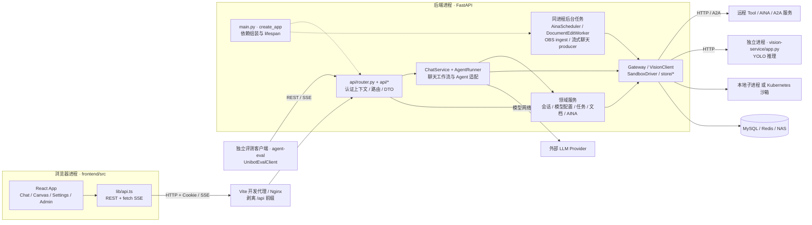
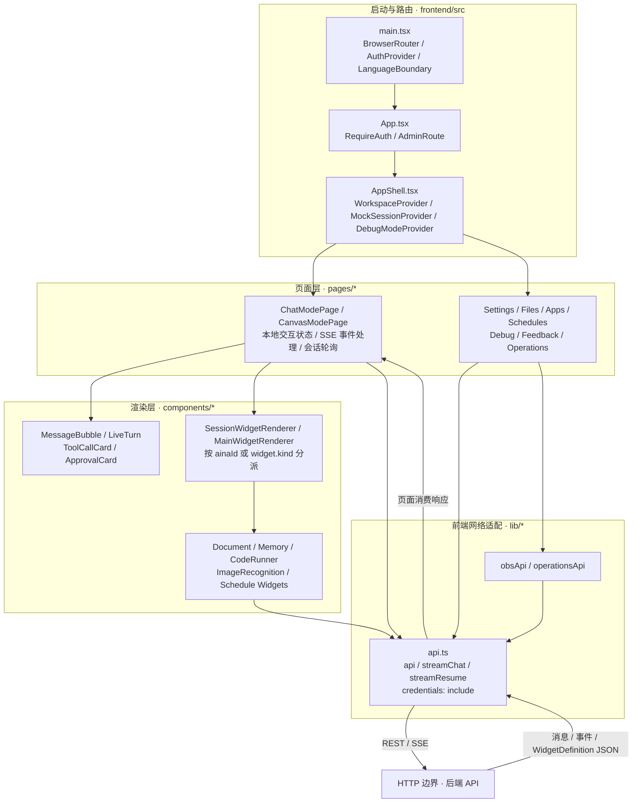
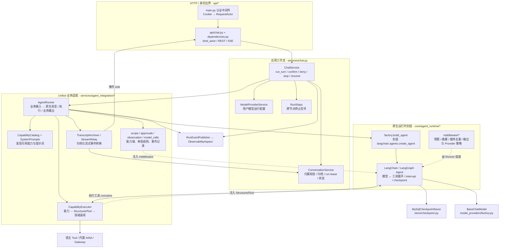
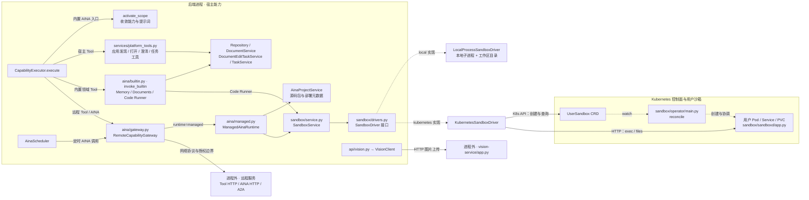
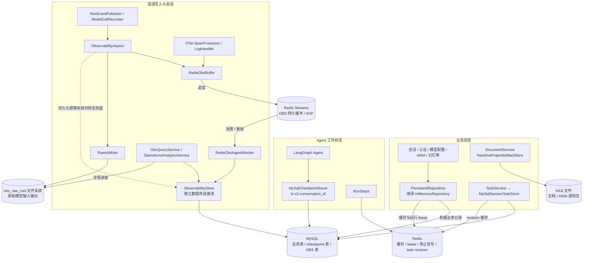
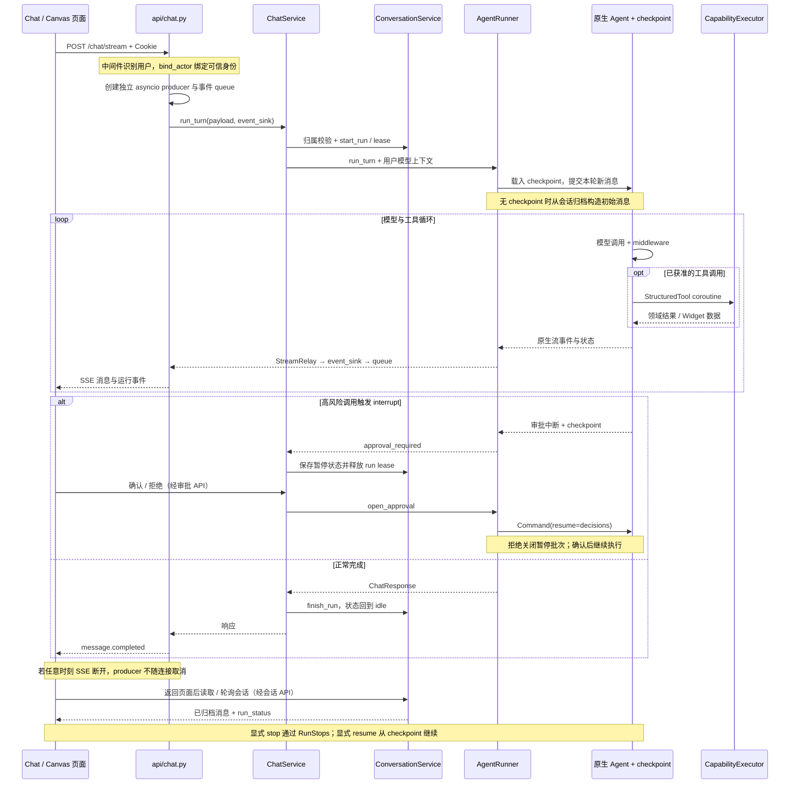

# Unibot 代码边界与关系图

基于 2026-09-30 当前工作区源码。本文描述已实现的结构，而非目标架构；省略数据模型和辅助函数的逐项依赖。

读图约定：实线表示调用、依赖或数据传递，边上的文字说明具体语义；虚线表示组装、接口实现或控制关系。只有明确标注的进程、HTTP、存储边界代表运行时隔离，其余 subgraph 是同一进程内的代码模块边界。后端路径均相对于 `backend/src/tianzhou_agent_platform/`。

## 1. 系统与进程边界

- `main.py` 是组合根，主要对象通过 `app.state` 注入；图中的模块不等于独立微服务。
- 默认持久化实现使用 **MySQL**。README 目录树中的 PostgreSQL 标注与当前实现不一致；`store/s3/` 也未被 `create_storage_stores()` 接入。
- `agent-eval` 通过公开 HTTP 接口访问后端，属于外部测试客户端。

依据：[main.py](../backend/src/tianzhou_agent_platform/main.py)、[store/lifecycle.py](../backend/src/tianzhou_agent_platform/store/lifecycle.py)、[nginx.conf](../frontend/nginx.conf)、[vite.config.ts](../frontend/vite.config.ts)、[评测客户端](../agent-eval/unibot_eval/client.py)。

## 2. 前端代码边界与 UI 协议

`WidgetDefinition` 是前后端之间的声明式数据契约。实际组件由宿主前端提供，不是从 AINA 下载 React 代码。部分专用 Widget 直接调用领域 API，例如图片识别走 `/vision/detect`，不必经过 Agent。`MockSessionProvider` 的名字不代表所有请求都走 mock；MSW 仅在开发模式且显式开启 `VITE_ENABLE_MOCKS` 时启动。

依据：[main.tsx](../frontend/src/main.tsx)、[App.tsx](../frontend/src/App.tsx)、[ChatModePage.tsx](../frontend/src/pages/ChatModePage.tsx)、[MainWidgetRenderer.tsx](../frontend/src/components/widgets/MainWidgetRenderer.tsx)、[api.ts](../frontend/src/lib/api.ts)、[widgets.py](../backend/src/tianzhou_agent_platform/aina/protocol/widgets.py)。

## 3. 后端聊天：应用工作流、业务适配与原生运行时

- `ChatService` 负责一次业务运行的生命周期；`AgentRunner` 将业务语义适配到原生 Agent。
- `core/agent_runtime/factory.py` 接收原生模型、工具、middleware、checkpointer，不接收 `ChatRequest`，不读取会话，也不处理 HTTP SSE。
- 图中是职责边界，并非严格依赖倒置架构：部分 `api/*` 和 AINA 代码直接依赖 repository；`CapabilityExecutor` 也直接持有 repository、gateway 和领域服务。
- `ConversationService` 通过 `ConversationRepository` 等 Protocol 访问存储；生产组装注入 `PersistentRepository`。这种接口边界没有覆盖全项目。

依据：[ChatService](../backend/src/tianzhou_agent_platform/services/chat.py)、[AgentRunner](../backend/src/tianzhou_agent_platform/services/agent_integration/runner.py)、[运行时工厂](../backend/src/tianzhou_agent_platform/core/agent_runtime/factory.py)、[CapabilityExecutor](../backend/src/tianzhou_agent_platform/services/agent_integration/executor.py)、[会话存储协议](../backend/src/tianzhou_agent_platform/conversations/repository.py)。

## 4. 能力执行边界：内置、远程、托管与沙箱

- 内置 AINA 入口调用 `activate_scope()`，之后由同一个宿主 Agent 调用该能力域的工具；不会通过 Gateway 调用内置 AINA，也不等同于打开 Canvas。
- Gateway 按 `runtime.type` 区分远程与托管。托管 AINA 将执行交给 SandboxService；定时调度也直接调用 Gateway。
- 本地驱动只是子进程边界，不能当作容器或 gVisor 隔离。启用认证时，本地执行须显式允许；Kubernetes 驱动可指定 RuntimeClass，实际隔离由部署配置决定。
- Operator 负责生命周期控制；执行请求由后端驱动直接发给 `sandboxd`，不经 Operator 转发。
- 图片识别当前走独立 `/vision` API。虽然注册为内置 AINA，其推理调用不在 `invoke_builtin()` 的工具分派中。

依据：[executor.py](../backend/src/tianzhou_agent_platform/services/agent_integration/executor.py)、[gateway.py](../backend/src/tianzhou_agent_platform/aina/gateway.py)、[builtin.py](../backend/src/tianzhou_agent_platform/aina/builtin.py)、[managed.py](../backend/src/tianzhou_agent_platform/aina/managed.py)、[drivers.py](../backend/src/tianzhou_agent_platform/sandbox/drivers.py)、[factory.py](../backend/src/tianzhou_agent_platform/sandbox/factory.py)、[Operator](../sandbox/operator/main.py)、[Vision API](../backend/src/tianzhou_agent_platform/api/vision.py)。

## 5. 状态归属与持久化边界

- 会话消息归档、Agent checkpoint、观测数据是三份不同职责的数据。checkpoint 是工作状态，不能等同于完整历史归档；Runner 在调用后裁剪旧 checkpoint。
- OBS 启用时走 Redis Streams → ingest worker → MySQL。
- OBS 原始输入输出写入 `obs_raw_root`，不经过 `NasStore`，不应默认画成同一块业务 NAS。
- 不提供持久化配置时，`create_app()` 可组装 InMemoryRepository / InMemorySaver / InMemorySessionTaskStore；正式模块入口传入 StorageSettings。

依据：[main.py](../backend/src/tianzhou_agent_platform/main.py)、[repository.py](../backend/src/tianzhou_agent_platform/store/repository.py)、[checkpoint.py](../backend/src/tianzhou_agent_platform/store/checkpoint.py)、[tasks/store.py](../backend/src/tianzhou_agent_platform/tasks/store.py)、[observability/service.py](../backend/src/tianzhou_agent_platform/observability/service.py)、[observability/stream.py](../backend/src/tianzhou_agent_platform/observability/stream.py)。

## 6. 聊天、审批与断线恢复时序

连接恢复、审批续跑、停止后续跑是三种不同机制。后台 producer 仍在 FastAPI 进程中，SSE 断开不取消执行不等于进程崩溃后任务自动继续。

依据：[api/chat.py](../backend/src/tianzhou_agent_platform/api/chat.py)、[services/chat.py](../backend/src/tianzhou_agent_platform/services/chat.py)、[runner.py](../backend/src/tianzhou_agent_platform/services/agent_integration/runner.py)、[run_stops.py](../backend/src/tianzhou_agent_platform/services/run_stops.py)、[ChatModePage.tsx](../frontend/src/pages/ChatModePage.tsx)。
